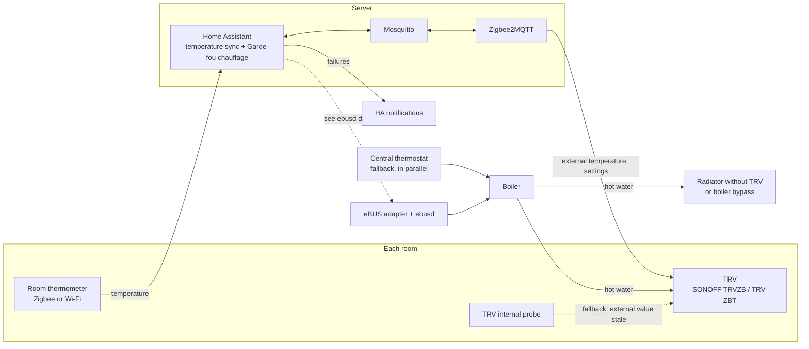

# Heating

Manual rules and procedures only. Automated config: HA automations "Garde-fou chauffage" + "Sync température <room>" (blueprint `ha/config/blueprints/automation/local/trvzb_external_temperature.yaml`), `z2m/.env`.

## Architecture

## Resilience rules

- Any component may fail → heating keeps working, degraded.
- **Always keep one radiator without TRV**, or with a TRV setpoint above the central thermostat setpoint:
  - boiler always has an open water path;
  - central thermostat room never throttled by a TRV → the thermostat reaches its setpoint and stops the boiler.
- Boiler bypass present → all TRVs closed is normal operation.

## Failure matrix

| Failure                                  | Effect                                                      | Manual action             |
| ---------------------------------------- | ----------------------------------------------------------- | ------------------------- |
| Server / HA / MQTT / Z2M / coordinator   | TRVs on internal probe, last setpoint kept                  | None                      |
| Room thermometer                         | TRV on internal probe until the sensor reports again        | Fix the sensor            |
| TRV reboot (batteries, OTA)              | Settings reset, re-applied automatically; `system_mode` not | Check `heat` after an OTA |
| TRV battery low                          | TRV-ZBT: valve 30 % open. TRVZB: no fallback                | Replace batteries         |
| TRV dead or removed                      | Valve body fully open → radiator heats freely               | Swap the head             |
| eBUS adapter / ebusd, central thermostat | Boiler on the remaining controller                          | See ebusd doc             |

## Rebuild from scratch

1. Hydraulics: radiator without TRV / bypass present.
2. Pair the room thermometers.
3. Pair each TRV in Z2M: friendly name `Radiateur <room>`, "update Home Assistant entity ID" checked. New room → add it to "Garde-fou chauffage" + a "Sync température" automation from the blueprint.
4. Apply pending OTA updates before calibrating → an OTA reboots the TRV.
5. Mount + calibrate on its radiator — again each time a head moves to another radiator:
   - TRV-ZBT: HA button `valve_travel_calibration`;
   - TRVZB: batteries out/in → wait until the icon stops flashing → mount → short press on the middle button → "Ad" for ~5 s;
   - check: `closing_steps` / `idle_steps` change.
6. Setpoints and schedules: from HA, never on the device.

## Known behaviour

- TRV temperature shown in HA (`local_temperature`) lags the room thermometer up to 1 h: reported on a 0.5 °C change or hourly. Regulation uses the pushed value immediately.
- Heating speed set by the boiler (flow temperature, power), not by the TRV. Boost (setpoint 30 °C, ≤ 180 min) → no faster than PID far from setpoint → hidden. Warm-up before arrival → raise the setpoint earlier from HA.
