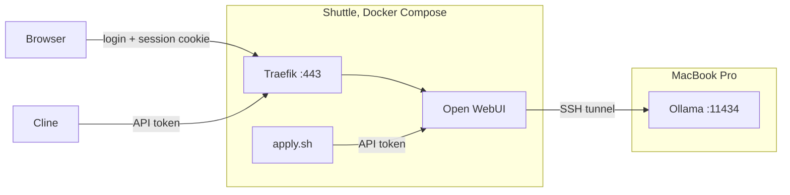

# Open WebUI (`openwu`)

Browser chat + Cline. No model runs here: inference on a MacBook Pro M1 Pro, 32 GB unified memory, over a reverse SSH tunnel the Mac opens ([`../docs/remote-access.md`](../docs/remote-access.md)). Tunnel down → no model at all.

Models and `num_ctx` sized for that machine: **24.5 GiB usable GPU memory** (`iogpu.wired_limit_mb`, 75 % of 32 GB). No transfer to another host.



## Presets

Source of truth: [`presets.json`](./presets.json), in the API's own payload shape. Stored in SQLite inside a Docker volume → never edit through the UI.

```bash
./openwu/apply.sh   # push every preset
```

- Key: `OPENWU_KEY` in `.env`, admin role. Regular key → also needs `workspace.models_import` and write access on every existing preset. Compose passes it to the container → a new key needs `docker compose up -d openwu`.
- `/import` merges per top-level key, replaces `params` wholesale → an omitted `meta` or `access_grants` survives, an incomplete `params` drops what it leaves out.

Values:

- `num_ctx`: measured per model → [`bench.md`](./bench.md). A Modelfile's own `num_ctx` is a packaging guard rail, never a target: the preset is always meant to override it, and a preset that omits it inherits that guard rail instead.
- Sampling: only to deviate from the packaged Modelfile profile (`ollama show <tag>`). `coding-s` → Instruct/General, `coding-m` → Thinking/Precise coding. Sources: [Qwen3.5-4B](https://huggingface.co/Qwen/Qwen3.5-4B), [Qwen3.5-9B](https://huggingface.co/Qwen/Qwen3.5-9B).
- Both cards: parameter support varies across inference frameworks → check `ollama show`, never assume.
- Omitted → falls through to the Modelfile.

Import does not fetch the model. A `base_model_id` the backend lacks → preset looks healthy, fails on the first message. Pull first: _Admin Panel → Settings → Connections_, **Manage** on the Mac's connection. The modal is bound to the connection it was opened from.

## Traps

- Source models cannot be hidden. `is_active: false` or a per-connection allow-list → the tag leaves `app.state.MODELS`, which the chat path checks → every preset built on it stops answering. Listing still resolves → presets look healthy until a message is sent. Verify by sending one. They therefore reach every API client listed next to the presets, indistinguishable — and a client that selects a source tag gets `OLLAMA_CONTEXT_LENGTH`, not the preset's `num_ctx` (verified: 8192 vs 131072, same model, both through Open WebUI). Ollama then truncates in silence and the client's own token counter, being post-truncation, cannot show it. Reach a model through its preset id only — going through Open WebUI is not enough.
- `num_ctx` precedence, weakest first: `OLLAMA_CONTEXT_LENGTH` < Modelfile `PARAMETER num_ctx` < preset `params` < Chat Controls. Layer 2 beats the environment variable. Chat Controls pre-fills with the application default, not the preset's → touching it caps that conversation.
- KV cache cost does not follow model size: factor 7 here, architecture decides → measure, never estimate. GGUF preallocates at load → fails loudly. MLX allocates on demand → fails mid-session.
- Ollama reuses a resident model → `ollama ps` reports the previous caller's context. Evict with `keep_alive: 0` before any reading.
- `think: true` removes the natural end of a generation. Root-level `max_tokens` → root-level `num_predict`, ignored by Ollama. Only `options.num_predict` counts → send it inside `params`.
- `task.model.default` empty → housekeeping calls run on the conversation's own model, nothing extra loaded. Another model on the same backend → every generated title evicts the large one.
- `ENABLE_PERSISTENT_CONFIG=false` → admin settings written through the UI or the API land in an in-process dictionary, not the database, and revert on restart. Must survive → `compose.yml`. Presets unaffected.
- `errp-redirect` replaces API error bodies with its own page → the status code survives, the explanation does not.
